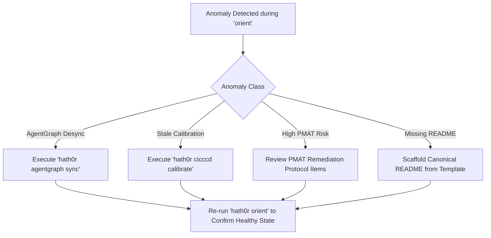

# Playbook: Repository Orientation Anomaly Diagnostic & Remediation

> Canonical Remediation Playbook · Hath0r Agentic Framework  
> Updated: 2026-10-12 · Issue: #275 / CLI #463

## 1. Trigger Conditions

This playbook is activated when `OrientBot` encounters anomalies during orientation:
- **AgentGraph Desync**: AgentGraph snapshot missing, corrupt, or containing 0 rules.
- **Uncalibrated Runtime State**: Continuous Calibration (CCCD) status is stale ($> 24\text{h}$) or parameters failed convergence.
- **High Architectural Risk**: PMAT reports Composite Hotspot Risk Index $R(f) \ge 0.75$ or provability score $< 0.85$.
- **Missing Project Identity**: Root repository missing `README.md` or missing ecosystem member definition.

---

## 2. Diagnostic & Remediation Protocol

### Remediation Protocol 1: AgentGraph Desync
1. Run `hath0r agentgraph sync` to re-index all `AGENTS.md`, `rules.md`, contracts, and documentation.
2. Validate graph integrity with `hath0r agentgraph validate`.

### Remediation Protocol 2: Calibration Drift
1. Run `hath0r cicccd calibrate --iterations 5`.
2. Inspect `cccd_state.json` to verify updated timestamp and freshness flag.

### Remediation Protocol 3: PMAT Hotspots
1. Identify highest-risk files in the PMAT table of the orientation report.
2. Refactor complex branches, reduce churn, and add formal contract assertions.
