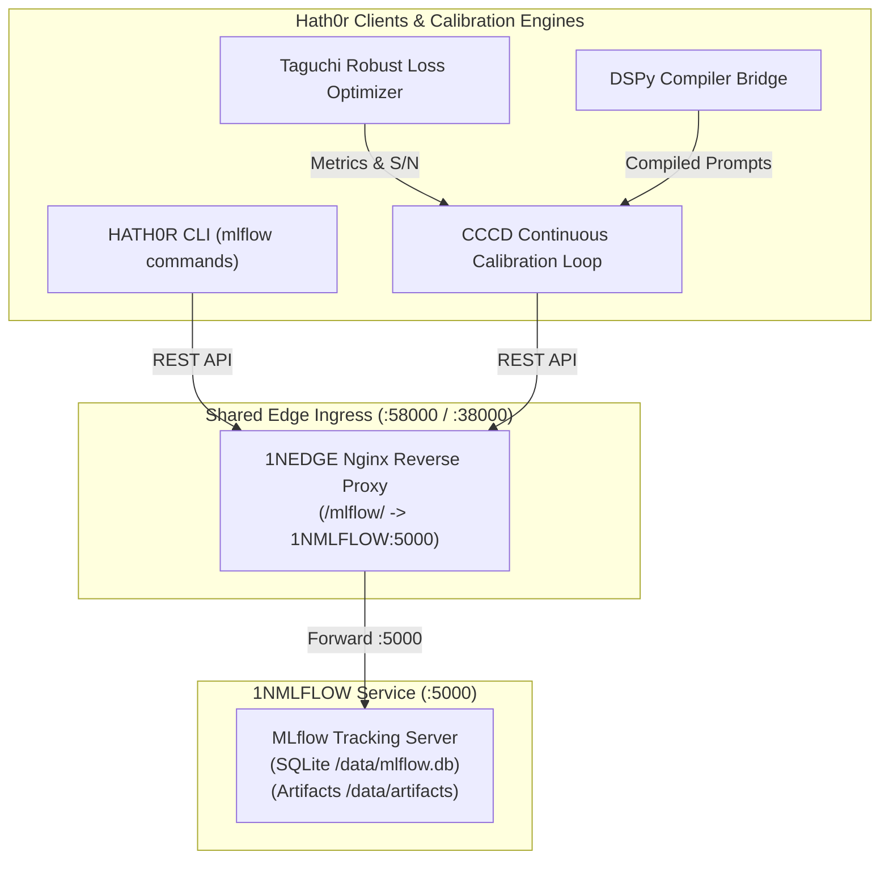

# MLflow MLOps & Experiment Tracking Strategy

> Artifact: **Strategy** · Suite: `hath0r-opensource` / `bayly-ai` / `1-nation`  
> Canonical Standard: `CR-SUBSTRATE-001`, `CR-CICCCD-001`, `CR-CLI-FEATURE-STANDARD-001`  
> Issue Reference: Bayly-AI/HATH0R-CLI#412  
> Date: 2026-10-11

## 1. Executive Summary

This strategy establishes MLflow as the canonical open-source MLOps experiment tracking, model/prompt registry, and continuous calibration metrics store across the Hath0r and 1-Nation ecosystem. While Arize Phoenix serves real-time runtime span tracing and LLM evaluations, MLflow specializes in:
1. **Hyperparameter & Calibration Sweeps**: Taguchi array iterations, S/N ratios, and quality loss metrics logged during CCCD execution.
2. **Compiled Prompt Signatures**: Versioned DSPy compiled prompt signatures, few-shot exemplars, and telemetry state snapshots.
3. **Model & Tool Artifact Registry**: Registered ML/LLM models, embedding weights, and fine-tuning artifacts.

---

## 2. Architectural Topology

---

## 3. Core Principles

- **Zero Heavy Client Dependencies**: The CLI and CCCD integration communicates with the MLflow tracking server via standard HTTP REST APIs without forcing large PyPI dependencies on lightweight edge containers.
- **Edge Routing Strictness**: External developer workstations access MLflow through the shared suite edge (`http://localhost:58000/mlflow/`). No unauthenticated direct host ports are published.
- **Continuous Calibration Traceability**: Every calibration run automatically produces an immutable run record in the `cccd-calibration` experiment linking Taguchi optimal parameters and S/N metrics to the compiled DSPy signature.
