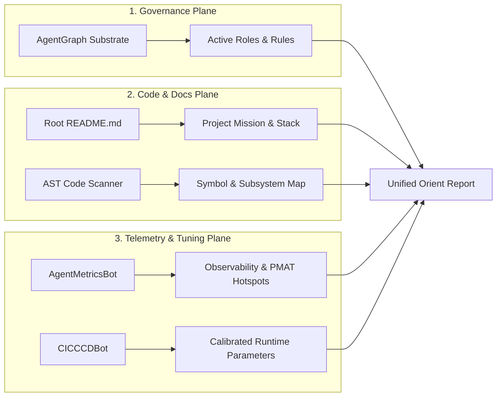

# Strategy: Unified Repository Orientation & Cognitive Calibration Strategy

> Canonical Strategy Specification · Hath0r Agentic Framework  
> Updated: 2026-10-12 · Issue: #275 / CLI #463

## 1. Executive Summary & Strategic Objectives

Autonomous agents and human operators frequently transition across polyglot repositories within the Hath0r suite (`HATH0R-CLI`, `hath0r-framework`, `hath0r-poc`). To prevent cold-start latency, context hallucinations, unauthorized tool invocation, and stale calibration drift, the **Unified Repository Orientation Strategy** establishes a standardized, 6-stage operational protocol triggered by the command `"orient"`.

The strategy fulfills three core pillars:
1. **Zero-Prompt-Tax Governance Discovery**: Instead of dumping entire rulebooks into LLM context, `orient` extracts scoped agent roles and governing rules directly from the local AgentGraph quad-graph substrate (`KnowledgePlane` + `RulesPlane`).
2. **Structural Code & Architectural Grounding**: Rapidly outlines the application topology, core classes, entry points, and subsystems via AST symbol parsing and README extraction without exhausting prompt token budgets.
3. **Continuous Metric & Calibration Freshness**: Simultaneously pulls live agent observability (latencies, token histograms, PMAT provability/hotspot risk indices) and runs Continuous Calibration (CCCD) to tune runtime parameters before tasks commence.

---

## 2. Architectural Protocol Pipeline

---

## 3. Compliance & Governance Integration

- **CR-CLI-ENTRY-001**: Accessible via CLI (`hath0r orient`) and agent conversational trigger (`orient`).
- **CR-AGENTGRAPH-001**: Queries quad-graph planes without unbounded prompt loading.
- **CR-CICCCDCT-001**: Calibrates runtime parameters and enforces freshness SLA ($\le 24\text{h}$).
- **Contract Schema**: Validated against `contracts/hath0r-orient-report-v1.schema.json`.
