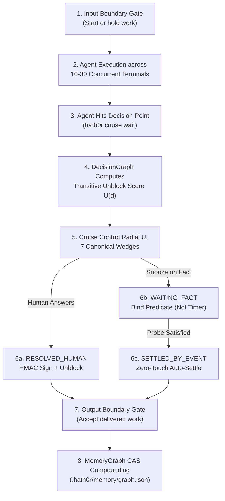

# Workflow: Hath0r Cruise Control Lifecycle

> Canonical Workflow · ID: `WORKFLOW-DECISION-RADAR-001`  
> Config: `cfg/workflows/decision-radar-workflow.yaml` · Epic: #499 / #508

---

## 1. End-to-End Decision & Settlement Flow

---

## 2. Stage Specifications

1. **Stage 1 (`input_boundary_gate`)**: Validates prompt scope, token budget cap, and permitted tools before agent execution begins.
2. **Stage 2 (`impact_reranking`)**: Evaluates transitive reachability in `DecisionGraph` and orders all waiting questions descending by $U(d)$.
3. **Stage 3 (`fact_settlement_loop`)**: Evaluates `file.exists`, `memory.fact.asserted`, `agent.task.completed`, `git.pr.merged`, `ci.workflow.passed`, and `endpoint.health.ok` predicates.
4. **Stage 4 (`output_boundary_gate`)**: Signs off unified code diffs and test artifacts with HMAC-SHA256 tokens and compounds `decision:<id>` nodes into `.hath0r/memory/graph.json`.
