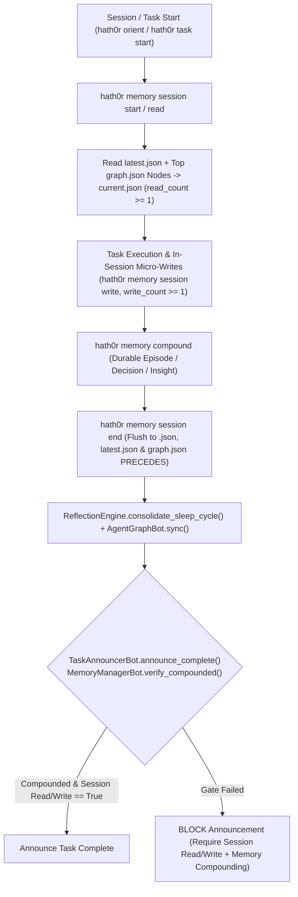

# MemoryGraph Compounding & Micro Memory Session Workflow Specification

> **Factory Binding**: `end-of-task-factory.yaml` · `repo-onboarding-factory.yaml` · `start-of-task-factory.yaml`  
> **Rule Binding**: `CR-MEMORY-COMPOUND-001`

## 1. Workflow Diagram

## 2. Declarative Lifecycle Steps

### Start of Session / Task (`hath0r orient` / `hath0r task start`)
1. `memory-manager-bot: session-start` (Reads prior `latest.json` and top `graph.json` nodes into `current.json`, sets `read_count >= 1`, writes initial task focus).

### In-Session Execution
2. `memory-manager-bot: session-write` (Appends compact micro-entries `<2KB` to `current.json`, sets `write_count >= 1`).
3. `memory-manager-bot: session-read` (Reads back active micro-session capsule on demand).

### End of Task (`end-of-task-factory.yaml` / `hath0r task finish`)
1. `deploy-test-bot: pre-deploy`
2. `pr-bot: create-pr`
3. `documentation-bot: generate-summary`
4. `pr-bot: monitor-checks`
5. `pr-bot: merge-pr`
6. `git-janitor-bot: prune-branch`
7. `git-janitor-bot: pull-development`
8. `documentation-bot: share-knowledge`
9. `memory-manager-bot: compound` (Compounds task/PR knowledge into `.hath0r/memory/graph.json`, writes & flushes micro-session, runs reflection synthesis, and syncs AgentGraph)
10. `memory-manager-bot: verify` (Enforces pre-announcement MemoryGraph + Micro Session read/write gate)
11. `change-validation-bot: validate-all`
12. `task-announcer-bot: announce-complete` (Verifies `MemoryManagerBot.verify_compounded()` before broadcasting completion)
