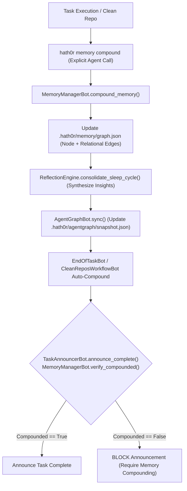

# MemoryGraph Compounding Workflow Specification

> **Factory Binding**: `end-of-task-factory.yaml` · `repo-onboarding-factory.yaml`  
> **Rule Binding**: `CR-MEMORY-COMPOUND-001`

## 1. Workflow Diagram

## 2. Declarative Factory Steps (`end-of-task-factory.yaml`)

1. `deploy-test-bot: pre-deploy`
2. `pr-bot: create-pr`
3. `documentation-bot: generate-summary`
4. `pr-bot: monitor-checks`
5. `pr-bot: merge-pr`
6. `git-janitor-bot: prune-branch`
7. `git-janitor-bot: pull-development`
8. `documentation-bot: share-knowledge`
9. `memory-manager-bot: compound` (Compounds task/PR knowledge into `.hath0r/memory/graph.json`, runs reflection synthesis, and syncs AgentGraph)
10. `memory-manager-bot: verify` (Enforces pre-announcement MemoryGraph gate)
11. `change-validation-bot: validate-all`
12. `task-announcer-bot: announce-complete` (Verifies `MemoryManagerBot.verify_compounded()` before broadcasting completion)
