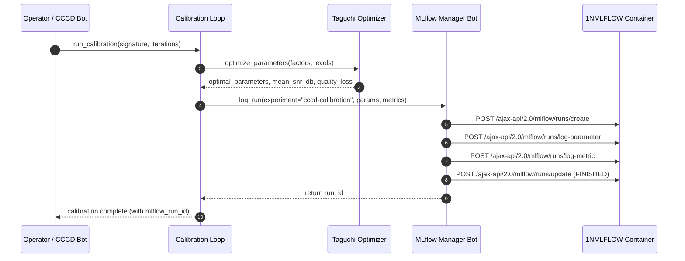

# Workflow: MLflow Continuous Calibration & MLOps Pipeline

> Artifact: **Workflow** · Suite: `hath0r-opensource` / `bayly-ai` / `1-nation`  
> Canonical Standard: `CR-CLI-FEATURE-STANDARD-001`, `CR-CICCCD-001`  
> Issue Reference: Bayly-AI/HATH0R-CLI#412  
> Date: 2026-10-11

## 1. Overview

This workflow links Continuous Calibration (CC) triggers to MLflow experiment tracking.

---

## 2. Automated Pipeline Steps

1. **Trigger**: Calibration initiated via `hath0r cccd calibrate`, periodic auto-tune daemon, or PR promotion gate.
2. **Execution**: DSPy compile and Taguchi OATS array evaluation.
3. **Tracking**: Optimal hyperparameters and loss metrics written to MLflow database.
4. **Validation**: Quality gate validates S/N ratio against threshold before parameter promotion.
