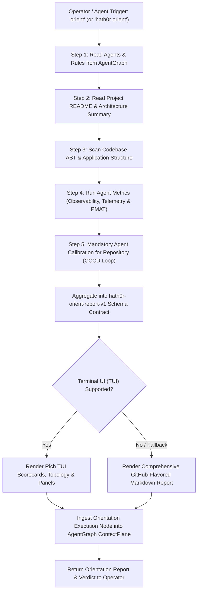

# Workflow: Repository Orientation Workflow

> Canonical Workflow Definition · Hath0r Agentic Framework  
> Updated: 2026-10-21 · Issue: #275 / CLI #463

## Supported Intent Triggers
1. `"orient"`
2. `"hath0r orient"`
3. `"run orient"`
4. `"orient repository"`
5. `"orientation report"`
6. `"system orientation"`

---

## Mandatory Repository Calibration Obligation (CRITICAL)

When running **orient** (or receiving an orientation request), the agent **MUST** ensure it calibrates itself for the target repository before undertaking any operational or development tasks:

1. **Trigger Calibration Loop**: Execute on-demand Continuous Calibration (`hath0r cccd calibrate` or `OrientBot.run_agent_calibration()`) to re-tune hyper-parameters tuned specifically for the target repository's code, structure, and prompt requirements.
2. **Verify Calibration Freshness**: Verify that repository calibration freshness in `.hath0r/cccd_state.json` meets the SLA ($\le 24\text{h}$). If missing or stale, trigger immediate re-calibration.
3. **Adopt Calibrated Hyperparameters**:
   - `temperature` (calibrated model creativity / deterministic precision)
   - `max_tokens` (output ceiling)
   - `top_p` (nucleus probability threshold)
   - `retry_count` (automated failure retry limit)
   - `guardrail_threshold` (safety and compliance validation gate)
4. **Cognitive Policy Ingestion**: Bind repository-specific AgentGraph roles, permitted/forbidden tools, and governing rule policies (`.hath0r/agentgraph/snapshot.json`) into the agent's active operational context.
5. **Report Calibrated State**: The generated orientation scorecard MUST explicitly present the CCCD calibration status, run ID, and calibrated parameters to the operator.

---

## Six Core Execution Stages

1. **AgentGraph Retrieval**: Ingest and extract active agents, roles, permissions (RBAC), and governing rule policies from the unified quad-graph substrate (`.hath0r/agentgraph/snapshot.json`).
2. **Project README Analysis**: Ingest repository root `README.md` / `TECH_README.md` to extract high-level mission, ecosystem membership, tech stack, and primary capabilities.
3. **Application Code Scanning**: Perform AST and structural inspection across codebase directories (`src/`, `lib/`, `contracts/`, `tests/`), capturing language distributions, symbol outlines, and entry points.
4. **Agent Observability Metrics**: Execute `AgentMetricsBot` to extract latency quantiles (P50/P90/P99), total inference spend/tokens, histogram distributions, and PMAT hotspot risk indices ($R$).
5. **Mandatory Agent Calibration**: Execute `CICCCDBot.calibrate()` (or `hath0r cccd calibrate`) to calibrate the agent specifically for the repository, tuning hyperparameters and persisting state to `.hath0r/cccd_state.json`.
6. **Unified Findings Report**: Synthesize findings into dual-mode TUI / Markdown report, surface calibration parameters, and record audit node into AgentGraph `ContextPlane`.
