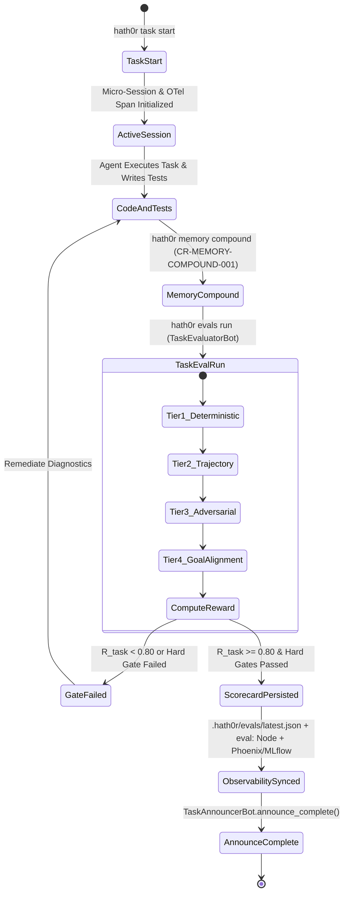

# Workflow: Automatic Task Evaluation Lifecycle (`CR-TASK-EVAL-001`)

> Canonical Governance Workflow · ID: `WF-TASK-EVAL-001`  
> Epic: #510 · Factory: `cfg/factories/end-of-task-factory.yaml`

---

## 1. State Machine Diagram

---

## 2. Factory Step Binding (`end-of-task-factory.yaml`)

In `cfg/factories/end-of-task-factory.yaml`:
- `task-evaluator-bot` executes `run-eval` with `on_failure: abort` prior to PR merge and completion announcement.
- `task-announcer-bot` verifies both `MemoryManagerBot.verify_compounded()` and `TaskEvaluatorBot.verify_evaluated()`.
